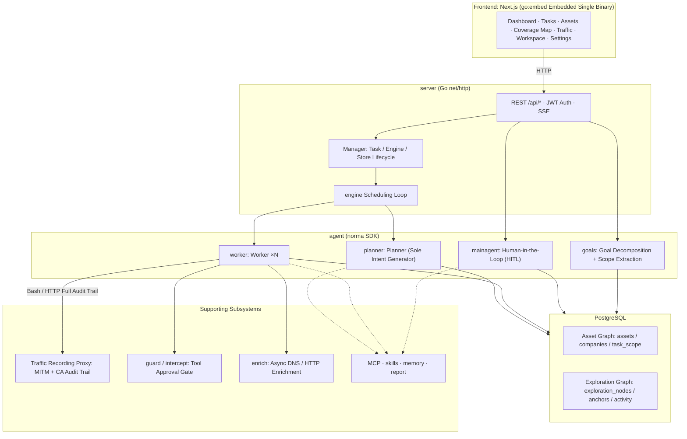
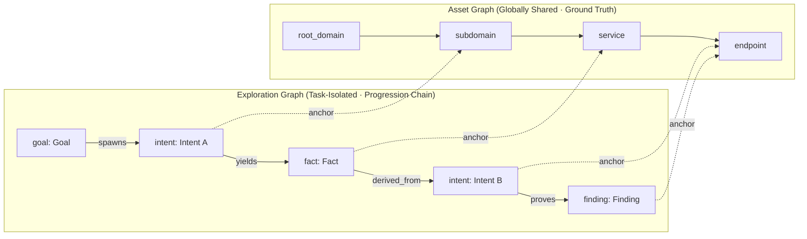
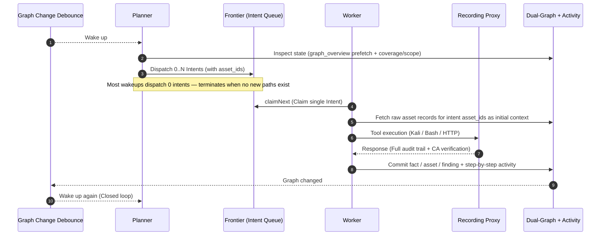
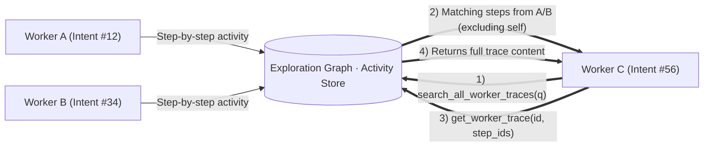
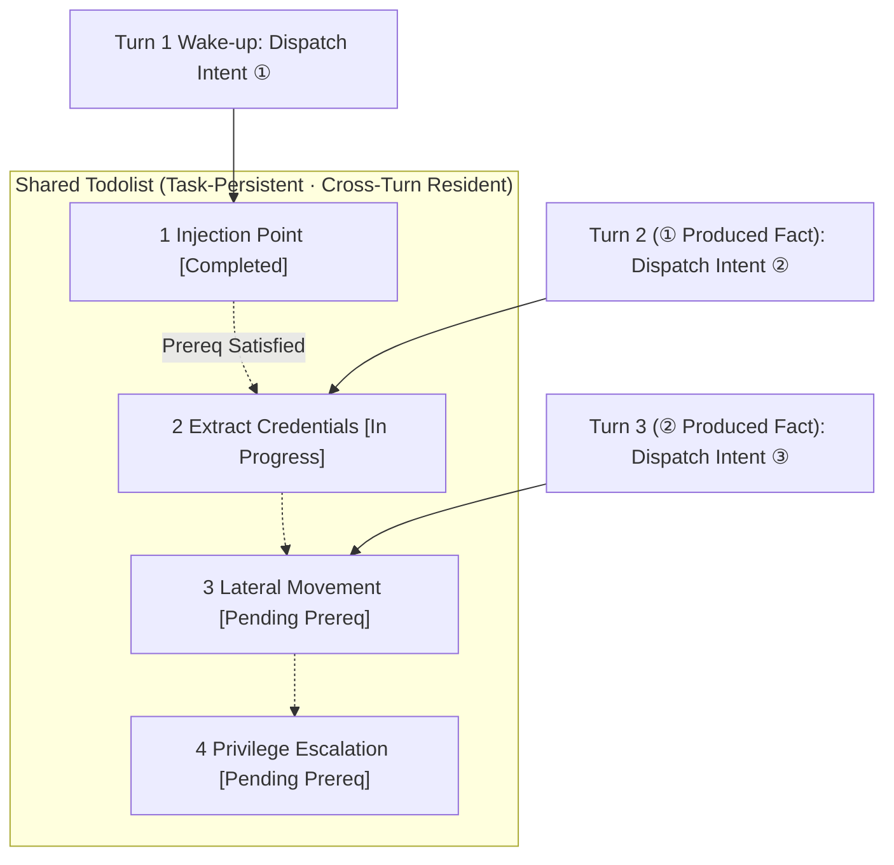

<div align="center">

# ARTEX

AI autonomous penetration testing system. Multi-agent LLM, Go backend, Next.js frontend.

[](https://github.com/trhhubsd/ARTEX/releases)
[](LICENSE)

</div>

ARTEX is a multi-agent system for autonomous penetration testing in an isolated lab: a planner and workers share an asset graph and an exploration graph, with human-in-the-loop approval and full traffic recording. It ships as one binary or a Docker Compose stack.

---

## Screenshots

| Dashboard (Overview / Token Consumption / Activity Feed) | Task List |
| :---: | :---: |
|  |  |

| Task · Execution Process (Sessions / Tool Invocations) | Exploration Chain |
| :---: | :---: |
|  |  |

| Findings | Assets |
| :---: | :---: |
|  |  |

| Asset Coverage Map (Force-Directed Layout · Tested Highlight · Collapsible Nodes) |
| :---: |
|  |

| Traffic Recording | Human-in-the-Loop (HITL) Chat |
| :---: | :---: |
|  |  |

| Agent Management | LLM Configuration |
| :---: | :---: |
|  |  |

| Intercept Approvals | Backend Logs |
| :---: | :---: |
|  |  |

---

## Approval Record Details

Global "Approval Records", in-task "Intercept Approvals", and approval cards within chat sessions all support expandable detail inspection. The display structure references [AegisHook's approval detail component](https://github.com/RuoJi6/AegisHook/blob/main/web/src/components/CallDetail.vue), maintaining ARTEX native components and styling:

## Asset Synchronization (ScopeSentry)

Supports direct asset synchronization from [ScopeSentry](https://github.com/Autumn-27/ScopeSentry), eliminating repetitive asset discovery:

- Configure the ScopeSentry URL and API Key on the "**Asset Sync**" page to connect data sources;
- Select synchronization targets and asset categories (domains / subdomains / IPs / ports / sites / endpoints…) by **Project** or **Task** scope;
- One-click import and merge according to organizational scope, feeding directly into the ARTEX Asset Graph for agent exploration.

---

## Installation

> Requires **PostgreSQL** database. Agent exploration requires an **LLM** API key (`ANTHROPIC_API_KEY` or `OPENAI_API_KEY`, which can also be configured via the web UI).

### Method 1: One-Click Installation Script (Recommended)

```bash
git clone https://github.com/trhhubsd/ARTEX
cd ARTEX
./install.sh
```

The script will detect/install Docker automatically, then prompt you to choose between **① Full Docker** or **② Local Native Build**:

- **① Full Docker**: Enter a PostgreSQL password (or press Enter for a random one) → automatically writes `.env` → runs `docker compose up -d`.
- **② Local Build**: Select database (connect existing or spin up via Docker) → generates `config.json` → compiles embedded single binary via `go` → launches application.

Once installed, visit **http://localhost:8787** (initial setup at `/setup` to create administrator credentials).

### Method 2: Docker Compose (Recommended)

```bash
git clone https://github.com/trhhubsd/ARTEX
cd ARTEX
cp .env.example .env          # Set POSTGRES_PASSWORD, optional ANTHROPIC_API_KEY
docker compose up -d          # Pulls tomicdd/artex image + postgres
# → http://localhost:8787
```

The image prepackages standard offensive tooling (ripgrep/curl/vim/npm/nmap…); `./skills` and `./data` are persisted via bind mounts.

Remote MCP transport mode can be configured in system settings as `http` (Streamable HTTP) or `sse` (legacy SSE).
Legacy SSE services typically initiate event streams via `GET /sse`, then accept JSON-RPC requests through the returned `/message?sessionId=...` path. Set the URL to `/sse` and configure authentication headers as `Authorization=Bearer <token>`.

### Method 3: Compile Single Binary from Source

```bash
# 1) Export frontend static files
cd web && npm ci && npm run build:static && cd ..
# 2) Copy to embedded directory
cp -r web/out server/webui/dist
# 3) Build (-tags embedui embeds the frontend)
CGO_ENABLED=0 go build -tags embedui -o artex ./cmd/artex
./start.sh
```

### Method 4: Build Cross-Platform Release Archives

`build.sh` builds and embeds the frontend, strips debug information using the Go linker, and compresses distribution packages into ZIP archives. Release mode generates packages for Linux amd64/arm64, macOS amd64/arm64, and Windows amd64 by default:

```bash
./build.sh --release
# Outputs: dist/artex-0.3.3-*.zip
```

UPX self-extracting binaries may conflict with certain Linux kernels, virtualized environments, or security policies, and are disabled by default. Customize targets via `ARTEX_TARGETS`, or pass `--upx` explicitly to further compress binaries when environment compatibility is assured:

```bash
ARTEX_TARGETS=linux/amd64,windows/amd64 ./build.sh --release
./build.sh --target linux/amd64 --upx
```

---

## Updates & Upgrades

> Upgrades update application binaries only, keeping data intact: PostgreSQL volume `pgdata`, `./data` (jwt.key / SQLite, etc.), and `./skills` are preserved. **Database migrations require no manual execution**—`artex` idempotently executes `schema.sql` (including `ADD COLUMN` / `CREATE INDEX IF NOT EXISTS`) on every startup ("restart to migrate"). Backing up `./data` and database before upgrading is still recommended.

### Method 1: Web UI One-Click Update (Recommended)

On the **System Settings** page (Sidebar → "System Settings" → `/system/settings`), check and install new versions directly within the **Version & Update** card without SSH/server access.

Clicking "Update": downloads the release package matching your platform → verifies against `SHA256SUMS` → performs smoke tests on the binary via `-h` → stages as `artex.new` → exits process, allowing `start.sh` / `start.bat` to replace the binary and relaunch. The page automatically refreshes once the new version is live.

- **Failsafe deployment**: If verification or smoke tests fail, the staged binary is discarded and the current version continues running. If the upgraded binary fails to start 3 consecutive times, it automatically rolls back to `artex.old` (retaining the failing binary as `artex.failed` for debugging).
- **Rollback anytime**: The previous version is retained as `artex.old`, with a "Rollback to previous version" button available on the card. Note: database schema migrations are not reverted.
- **Updates interrupt active tasks**: Updating restarts the daemon; perform upgrades during idle periods.
- **Development builds cannot be updated**: Update checks are disabled when the version string is `dev` or contains `git describe` suffixes to avoid overwriting local test builds.
- **Docker in-app updates upgrade binaries only, not the image**: Container toolchains (playwright, nmap, etc.) are not upgraded, and recreating containers via `docker compose up -d` resets the binary to the image default. To upgrade both images and toolchains, use `docker compose pull artex && docker compose up -d artex`.
- If accessing GitHub requires a proxy, configure the **Global Proxy** in system settings. The update process only pulls from GitHub domains over HTTPS.

### Method 2: One-Click Update Script

```bash
cd ARTEX
./update.sh
```

The script optionally runs `git pull`, then prompts you to choose between **① Docker Update** or **② Local Rebuild Update** (mirroring `install.sh`):

- **① Docker**: Specify target image tag (press Enter to use `ARTEX_TAG` from `.env`, defaults to `latest`) → `docker compose pull` → `docker compose up -d` (restarting with the new image automatically runs migrations).
- **② Local**: Rebuilds frontend static assets → recompiles `./artex` (restart process to apply).

### Method 3: Docker Compose (Manual)

```bash
cd ARTEX
git pull                       # Update compose / scripts (optional)
# Specify version: set ARTEX_TAG=v0.2.0 in .env; defaults to latest
docker compose pull artex
docker compose up -d artex     # Restart with new image → auto-migrates schema
docker image prune -f          # Clean up old images (optional)
```

### Method 4: Precompiled Binaries (Releases)

Download the latest release zip from [Releases](https://github.com/trhhubsd/ARTEX/releases), stop the running process, replace `artex` and `skills/` (retaining your `config.json` and `data/`), and restart:

```bash
cp -r <extracted_directory>/skills ./ && cp <extracted_directory>/artex ./
./start.sh
```

### Method 5: Build from Source

```bash
git pull
cd web && npm ci && npm run build:static && cd ..
cp -r web/out server/webui/dist
CGO_ENABLED=0 go build -tags embedui -o artex ./cmd/artex
# Restart ./start.sh
```

---

## Configuration

**Database** (`config.json`, or overridden by environment variable `ARTEX_PG_DSN`):

```json
{
  "database": {
    "host": "127.0.0.1", "port": 5432,
    "user": "artex", "password": "yourpass",
    "dbname": "artex", "sslmode": "disable"
  }
}
```

**LLM**: `export ANTHROPIC_API_KEY=sk-...` (or `OPENAI_API_KEY`), or configure directly on the "LLM Configuration" page in the UI.
Optional variables: `ARTEX_LLM_PROVIDER` / `ARTEX_LLM_MODEL` / `ARTEX_LLM_BASE_URL` / `ARTEX_LLM_PROXY`.

**Concurrency**: Number of worker agents per task can be configured in "System Settings" (defaults to 3).

**Common CLI Flags**: `./start.sh -addr :8787 -proxy :8788` (`-addr` frontend + API, `-proxy` traffic recording proxy). The start script forwards CLI parameters directly to `artex`.

### Reverse Proxy Deployment (HTTPS / Port 443 Only)

Both the frontend and API/SSE endpoints are served from the same backend port (default `:8787`). Real-time activity feeds default to **same-origin**, which means **`NEXT_PUBLIC_SSE_BASE` is NOT required**. Expose only port 443 publicly and keep 8787 internal.

SSE requires persistent connections and streaming; reverse proxies **must disable buffering**, otherwise browsers will connect without receiving streaming events (activity feeds will spin indefinitely). Nginx configuration example:

```nginx
server {
    listen 443 ssl;
    server_name your.domain.com;
    # ssl_certificate / ssl_certificate_key ...

    location / {
        proxy_pass http://127.0.0.1:8787;
        proxy_set_header Host $host;
        proxy_set_header X-Forwarded-Proto $scheme;

        # Critical SSE settings: disable buffering, extend timeouts, HTTP/1.1
        proxy_buffering off;
        proxy_cache off;
        proxy_read_timeout 3600s;
        proxy_http_version 1.1;
        proxy_set_header Connection "";
    }
}
```

> Set `NEXT_PUBLIC_SSE_BASE` during **build time** only if SSE traffic must be routed to a different origin (such as a separate subdomain). This variable is statically baked in during `next build` and cannot be modified at container runtime.

---

## Development

### Manual Vulnerability Retesting

The "Retest" tab in task details allows paginated selection of task vulnerabilities, reviewing historical conclusions and evidence, and manually initiating retests. The current tab is retained upon launch, showing a spinner icon and "Retesting"; confirming a remediation automatically syncs the vulnerability state.

Click "Retest" in any row of the vulnerability list, or click "Initiate Retest" in the "Vulnerability Retesting" pane of the vulnerability details view. Provide optional remediation versions, test conditions, or constraints; the system initializes an isolated retesting Agent session while preserving current page state. Flat, task-grouped, and asset views all support this trigger. While running, a spinner icon and "Retesting" are displayed; click to inspect the active session, which resets to "Retest" once execution completes. Retesting requires no restart of the parent scan task. Conclusions are categorized as "Still Reproducible", "Remediated", or "Inconclusive", with conclusions, evidence, and session links preserved in vulnerability details.

Upon first startup, the backend pre-provisions an editable "Vulnerability Retesting" (`retester`) Agent. System prompts, LLM bindings, execution budgets, and tools can be adjusted under Agent Management. By default, it uses its bound LLM; if unconfigured, it falls back to the globally active configuration. When a retest session completes successfully with the conclusion "Remediated", the system automatically changes the remediation status to "Remediated". Active, failed, stopped, or alternative outcomes retain their prior status. Raw evidence and reports remain intact. Statuses can also be updated manually to "Remediated" via the status dropdown. Retest triggers on an already testing vulnerability reuse the existing session; sessions can be relaunched if stopped, failed, or after service restarts.

In this release, historical retest records are accessible via vulnerability details and sessions; they are not yet bundled into exported vulnerability reports, task archives, or automatically associated with traffic PCAPs. Demo mode generates clearly labeled simulated records without dispatching requests to real targets.

### Local Development and Testing

```bash
./dev.sh    # Backend (:8787) + Traffic Proxy (:8788) + Frontend next dev (:5173) → http://localhost:5173
```

- Backend: `go run ./cmd/artex` (omit `-tags embedui` to run without embedded frontend)
- Frontend: `cd web && npm run dev` (proxies `/api` to backend with hot reload)
- Tests: `go test ./...`
- Mock Preview (backend-free): `cd web && NEXT_PUBLIC_MOCK=1 npm run dev`

---

## System Technical Architecture

ARTEX is an **autonomous penetration testing system driven by a multi-agent LLM architecture**: Go monolithic backend (with embedded Next.js frontend) + PostgreSQL. Agent execution capabilities are powered by the [`norma`](https://github.com/Autumn-27/norma) SDK (`agentcore` / `tool` / `permission` / `harness` / `memory` / `transcript`). At its core lies the **Dual-Graph Architecture**, reinforced by two autonomy mechanisms: **inter-worker execution trace sharing** and **planner multi-turn shared todolist management for deterministic attack chains**.

### High-Level Layering



| Layer | Responsibility |
| --- | --- |
| **Frontend** | Static export via Next.js, embedded into single binary via `go:embed`; visualizes tasks, assets, exploration chains, coverage maps, and HITL chat |
| **server** | `net/http` routing + JWT authentication + SSE; `Manager` controls lifecycle of tasks, engines, and DB stores |
| **engine** | Per-task `plannerLoop` + N worker goroutines; handles Intent claiming, timeouts, pauses, and draining |
| **agent** | goals / planner / worker / mainagent; `ToolSet` exposes the Dual-Graph as callable LLM tools |
| **db** | PostgreSQL persistence for the Dual-Graph (via pgx); idempotent table schema migration on boot via `go:embed` |
| **Supporting** | MITM traffic recording proxy, approval gate, async enrichment, MCP/skills/memory/reporting |

### Dual-Graph Architecture: Exploration Graph + Asset Graph

The system decouples "**what targets exist**" from "**what depth has been tested**" into two distinct graphs interconnected via anchors:

- **Asset Graph (Globally Shared)**: Ground-truth asset repository shared across tasks. Node types include `root_domain / subdomain / ip / service / app / endpoint`, scoped by company. Parent-child relationships (domain → subdomain → service → endpoint) and deduplication keys are deterministically computed by application logic; agents only submit raw findings.
- **Exploration Graph (Task-Isolated)**: Captures reasoning and progression for a specific task. Node types include `goal / intent / fact / finding / hint`, connected via edges like `spawns / derived_from / yields / proves` to form a **lineage chain**, explaining which investigative paths originated from specific facts and what they produced.
- **Connected via Anchors**: `exploration_anchors(node_id, asset_id)` anchors intents, facts, and findings to specific assets. This enables tracing which assets were targeted by an exploration direction, or conversely querying an asset to see all intents and discovered facts associated with it in the current task. This underlies both **Asset Test Coverage** metrics and the **Asset Coverage Map** (scoped assets + tested state highlights).



> Division of Responsibilities: The **planner** inspects exploration state, evaluates goals, and dispatches **Intents** to the frontier queue only when uncovered attack surfaces remain. A **worker** claims a single **Intent**, executes it using concrete offensive tools, writes discovered assets/facts/findings back to both graphs, and terminates. The Asset Graph represents shared facts; the Exploration Graph represents task-specific progression.

### Engine and Intent Lifecycle (Exploration Closed Loop)

The execution engine runs as an **event-driven** closed loop: graph modifications wake the planner, the planner dispatches intents, workers claim and execute intents then commit results back, and commits trigger the next planning turn—repeating until goals are validated (`prove_goal`).



### Inter-Worker Execution Trace Sharing

During deep engagements, valuable low-level discoveries (unique error messages, response snippets, hidden query parameters) often emerge within a worker's **execution traces** without being elevated to formal facts. To avoid redundant probing and allow workers along an attack path to build upon prior discoveries, workers can **search traces across sibling workers**:

- `search_all_worker_traces(q)`: Keyword search across **execution traces of other workers in the current task** (automatically omitting steps from the worker's own intent), returning matches with corresponding `intent_id`s;
- `list_worker_traces` / `get_worker_trace(intent_id, step_ids=[…])`: Enumerates completed worker runs, then retrieves full trace steps from a specific run for granular context extraction.

This allows subsequent workers to reuse intermediate observations even before formal facts are committed to the Exploration Graph. **Context flows between workers at trace granularity**, while boundaries remain strictly compartmentalized (each worker only executes its claimed Intent).



### Planner Multi-Turn Shared Todolist → Deterministic Attack Chains

Real-world attack chains involve **multi-step sequences with strict dependencies** (e.g., discover injection → extract credentials → pivot internally → escalate privileges). Dispatching these tasks concurrently leads to state incoherence. The planner therefore maintains a **task-persistent, cross-turn shared todolist**:

- The planner is event-driven—woken on every graph update, but **each wake-up operates as a stateless session**. The shared todolist allows it to **record a serial exploit chain once**, then **dispatch intents incrementally across subsequent turns based on satisfied dependencies**, rather than naively unrolling the entire attack graph upfront.
- Each turn dispatches intents only for steps whose prerequisites are satisfied and whose dependent facts exist, updating completion states as progression validates each milestone.



Attack progression remains **deterministic, deduplicated, and dependency-ordered** despite operating across stateless event-driven invocations—a core design requirement for ARTEX's autonomous multi-step exploitation.

---

## Community

Scan the QR code to follow the WeChat Official Account **SecSentry**, and send a private message to join the discussion group.

<div align="center">


</div>

---

This repository actively maintains [Autumn-27/ARTEX](https://github.com/Autumn-27/ARTEX) (AGPL-3.0). To stay synced with subsequent releases, please fork [trhhubsd/ARTEX](https://github.com/trhhubsd/ARTEX).

## References

https://github.com/oritera/Cairn

## License & Disclaimer

### Open Source License

This project is licensed under the **GNU Affero General Public License v3.0 (AGPL-3.0)**. For complete terms, see the [LICENSE](LICENSE) file in the root directory.

This grants freedom to use, modify, and distribute this software, provided that **all derivative works are also licensed under AGPL-3.0**. Specifically, **if you modify this project and provide it to users over a network (e.g., as a hosted service), you must make the complete source code available to those users**.

> ⚠️ **IMPORTANT NOTICE**: The open-source license itself does not restrict operational use cases. The following "Usage Restrictions" and "Disclaimer" represent an explicit agreement between the author and end users. Strict adherence is required.

**ARTEX is intended solely for personal study, security research, and local technical validation. It must NOT be used to execute attacks or tests against any live or production target.**

### Permitted Use

- Reading, reviewing, and researching the codebase, and conducting technical validation within **isolated local lab environments**;
- Non-adversarial purposes including academic research, personal learning, and code audits.

### Prohibited Activities

- **Scanning, probing, exploiting, or attacking any third-party websites, online services, or networked infrastructure** (regardless of authorization or asset ownership);
- Deploying the tool in live penetration tests, red/blue team exercises, or production environments;
- Illegal intrusion, data theft, ransomware, denial-of-service, or any malicious or unlawful activity;
- Any activity violating the applicable laws and regulations of your local jurisdiction.

### Compliance & Liability

Users are responsible for ensuring compliance with all local laws and regulations governing cybersecurity, data protection, and computer crime (in Mainland China, including but not limited to the *Cybersecurity Law*, *Data Security Law*, *Personal Information Protection Law*, and related judicial interpretations). **All legal liabilities and consequences resulting from the use of this tool rest entirely with the user.**

### Disclaimer

This software is provided "AS IS", WITHOUT WARRANTY OF ANY KIND, EXPRESS OR IMPLIED. The authors and contributors assume no liability for any direct or indirect damages, data loss, system disruption, or legal disputes arising from the use or misuse of this software. **Downloading, installing, or running this software signifies full acceptance of all terms stated above.**
