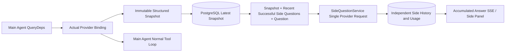

# ARTEX `/btw`

Standard chat, task Main Agent, and a task's own Workers support independent side questions. Type `/btw <question>` in the main input box to submit. Submitting an empty `/btw` or clicking the "Side Question" button opens the history view. The desktop UI uses a resizable sidebar panel, while mobile uses a Drawer.

Side question answers are generated against the agent's context snapshot at submission time, supporting streaming display, follow-up questions, cancellation, and clearing. Closing the panel, refreshing the page, or disconnecting the SSE connection will not cancel ongoing model requests. Canceling only affects the active side question; clearing cancels the active side question, deletes side question history, and preserves the main context snapshot.

## Implementation Boundaries

Built with Go, norma v0.3.7, Next.js, and existing Markdown / ResizablePanel / Drawer / AlertDialog components; norma source code was not modified, and no third-party dependencies were added for side questions. Planner agents, workers inherited from other tasks, and tool-based subtask upgrades are out of scope.

- `capture.go` only marks main loop requests in `Options.Deps.CallModel / CallModelSync`. The provider decorator wraps the concrete model after outer routing pool selection, recording the actually selected model; compaction and summary requests do not overwrite the snapshot.
- Snapshots are published on request start, full model responses, and terminal run states. In-flight partial replies are never published; tool calls stay paired via norma's `MessagesForAPI`, and tool results enter the snapshot on the next main model request or terminal run state. Stream interruption preserves the last valid boundary.
- Snapshots preserve structured messages, system prompts, tool definitions, and generation parameters via JSON deep copy. Model inference does not hold snapshot locks or database transactions.
- `SideQuestionService` calls the concrete provider directly; when necessary, it generates a side question summary first. The final answer allows at most one retry with compaction if the context limit is exceeded on the first attempt and no text/tool calls have been emitted yet. It does not create an agent session, connect to the tool executor, write to the main transcript, activity stream, or task graph, and does not go through the task model failover chain. Retaining tool definitions in the answer request ensures compatibility with existing structured tool contexts; summary requests omit tools. Newly returned tool calls have no execution path.
- One active request per parent session, capped at four across a single server process, with a 120-second timeout per request. Side questions run under independent cancellation contexts within the service lifecycle.
- Side question requests retain model profile references and non-sensitive identity digests; credentials are fetched from existing configurations at request time. If a profile is deleted, or its identity fields (model, protocol, endpoint) change, the main agent must run first to refresh the snapshot. Tests never modify the default product model.

## Persistence and Recovery

`db/schema.sql` automatically creates `side_question_sessions` and `side_question_requests`. The former stores parent resources, the latest snapshot, run ID, version, and clear version; the latter stores the question, accumulated answer, status, model, snapshot timestamp, usage, event sequence, and pagination ordinal.

Parent session keys use the conversation ID, or task ID + exploration ID + intent ID. Workers do not use reusable execution slot names.

Snapshots are merged and written by parent session, flushing every 250 ms. The database compares `(run_id, version)` to prevent stale versions from overwriting newer ones. Before submitting a side question, the selected snapshot is persisted again. Large in-memory snapshots are released upon successful write; failed writes retain pending versions. Accumulated answers are flushed at most every 250 ms as stream events arrive, saved immediately upon completion, with bounded retries on database errors.

On startup, lingering `running` requests are marked as `interrupted`, preserving persisted partial answers and usage without automatically replaying requests. The latest successfully saved context is directly available for the next question. Stale sessions without a snapshot require running the main agent first; context is never reconstructed from UI activity logs.

Clearing increments the clear version and deletes requests; conditional updates prevent late-arriving callbacks from writing back. Physical parent resource deletions cascade via foreign keys; logical worker deletions purge side question data within the same transaction and reject subsequent late snapshots. Task archiving blocks new requests, waits for the main flow to stop, cancels and waits for side questions to persist; the archive format is v3, remaining backward compatible with v1/v2 archives that lack side question tables.

Full history is retained, returning up to 20 items per page ordered by cursor. The model request replays up to the 20 most recent successful exchanges in full, bounded by the token budget; older exchanges are rolled into an independent rolling summary. When the main context exceeds the budget, only the older messages in the side question replica are summarized, retaining recent structured tool calls and results. Summaries, preparation progress, and usage all share the side question concurrency pool, cancellation context, and 120-second timeout. See [Context Budget & Compaction](CONTEXT_BUDGET.md).

## HTTP Contract

The following paths serve as `{parent}`, reusing existing authentication and resource validation:

- `/api/conversations/{id}`
- `/api/tasks/{id}/chat`
- `/api/tasks/{id}/intents/{iid}`

| Request | Response and Behavior |
| --- | --- |
| `GET {parent}/side-questions?before={ordinal}` | `items` in reverse chronological order, independent `current` run state, `snapshot` metadata, `next_cursor`; cursor 0 denotes latest page / end of pagination |
| `POST {parent}/side-questions` | JSON `{ "question": "…", "client_request_id": "UUID" }`; returns 202 with request object for new requests; returns 200 with existing object for idempotent ID and question match |
| `DELETE {parent}/side-questions` | Cancels and clears side questions for the current parent session |
| `GET /api/side-questions/{requestID}/events` | `snapshot` SSE events, `id` as incremental sequence, `data` with full accumulated request object; emits `cleared` when purged |
| `POST /api/side-questions/{requestID}/cancel` | Explicit cancellation; final state readable via history or SSE |

Questions are capped at 4,000 characters. Returns 409 when no snapshot exists, model profile changed, parent session is busy, or on idempotent ID conflicts; returns 429 when global concurrency is saturated. Every SSE connection sends the accumulated state upfront without relying on previously received text fragments. The frontend merges by request ID + sequence and discards stale callbacks when switching parent sessions or clearing.

## Validation and References

For automated checks, real model evaluation, and known limits, see [VALIDATION.md](VALIDATION.md).

Independent requests reference [Grok CLI side-question.ts (pinned commit)](https://github.com/superagent-ai/grok-cli/blob/fb97af83f06dca873281d60168430f06c8de6324/src/utils/side-question.ts), and runtime isolation references [OpenCode (pinned commit)](https://github.com/anomalyco/opencode/tree/b3f1a96c6dd7adeb28b36dd11add1998fc84d67b). ARTEX context relies on norma structured messages rather than concatenating text from frontend logs.
