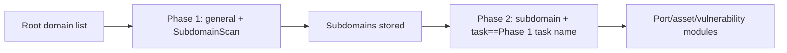

---

## name: scopesentry-mcp
description: Manage the ScopeSentry security scanning platform through the ScopeSentry MCP (projects, tasks, templates, assets, nodes). Use when the user mentions ScopeSentry, MCP, API Key, scan task, or asset query.

# ScopeSentry MCP Guide

For users with a **deployed ScopeSentry instance**. Connect to the platform through Cursor (or another MCP client). No local source is needed.

## 1. Preparation

### 1.1 Confirm the service is reachable

- Default Web UI: `http://<host>`
- MCP endpoint: `http://<host>/mcp` (if a reverse proxy or frontend proxy sits in front, use the actual `/mcp` address)

### 1.2 Create an API Key

1. Log in to the ScopeSentry Web UI in a browser
2. Open the **API Key** page and create a key (or create one through the admin-provided endpoint)
3. Save the returned `ssk_...` string (**shown only once**)

### 1.3 Configure Cursor MCP

Cursor → Settings → MCP → Add server:

```json
{
  "mcpServers": {
    "scopesentry": {
      "url": "http://<your-host>:8082/mcp",
      "headers": {
        "X-API-Key": "ssk_your-key"
      }
    }
  }
}
```

You can also use: `Authorization: Bearer ssk_your-key`

After saving, restart the MCP or reload Cursor and confirm that tools such as `list_projects` and `list_assets` appear in the tool list.

---

## 2. Tool overview


| Tool                     | Purpose                |
| ---------------------- | ----------------- |
| `list_projects`        | Project tree grouped by tag (includes project ID) |
| `list_projects_data`   | Paged project list, searchable by name     |
| `get_project`          | Project detail              |
| `create_project`       | Create project              |
| `list_tasks`           | Scan task list            |
| `get_task`             | Task detail              |
| `list_scan_templates`  | Scan template list            |
| `get_scan_template`    | Template detail              |
| `list_plugin_modules`  | Scan pipeline module names          |
| `list_plugins`         | Available plugins (with hash and default parameters) |
| `create_scan_template` | Create scan template            |
| `create_scan_task`     | Create scan task            |
| `list_assets`          | Query assets of each type (paged list)       |
| `count_assets`         | Count assets (`/api/assets/common/total`) |
| `get_asset_detail`     | Asset or vulnerability detail           |
| `add_asset_tag`        | Add a tag to an asset           |
| `list_nodes`           | Scan node list            |


Tool parameters follow the MCP tool description (schema). `list_assets` and `count_assets` share the same search and filter syntax; read the `list_assets` description before querying assets.

To get a total count, use `count_assets` (it maps to the Web paging total endpoint). Do not page through `list_assets` repeatedly just to count rows.

---

## 3. Common workflows

### 3.1 Query assets by project

When the user or context **already has a project condition**, pass `filter.project` first to narrow the scope. This avoids slow responses caused by too much cross-project data. If no project is defined, do not force a project filter.

1. `list_projects` or `list_projects_data` to get the target project **ObjectID** (`id` / `children[].value`)
2. `list_assets` with `filter.project` (**must be the ID, not the project display name**)

```json
{
  "asset_type": "asset",
  "pageIndex": 1,
  "pageSize": 20,
  "search": "domain=^example.com",
  "filter": {
    "project": ["<project ObjectID>"]
  }
}
```

### 3.2 Create a scan task

1. `list_nodes` to get online node names
2. `list_scan_templates` or `create_scan_template` to get the template **ObjectID**
3. `create_scan_task`: `name` and `node` are required; `template` takes the template ID (not the template name)

**Target source `targetSource` (same as the Web UI):**

| targetSource | Description | Required parameters |
| --- | --- | --- |
| `general` | Enter targets directly | `target` |
| `project` | Read targets from a project | `project` (array of project ObjectIDs) |
| `asset` | Search the Web asset library | `search`; optional `project`, `filter`, `targetNumber` |
| `RootDomain` | Search the root domain library | `search`; optional `project`, `filter`, `targetNumber` |
| `subdomain` | Search the subdomain library | `search`; optional `project`, `filter`, `targetNumber` |
| `UrlScan` | Search URL scan results | `search`; optional `project`, `filter`, `targetNumber` |
| `*Source` (e.g. `subdomainSource`) | Create from the asset page via "select/search" | use `search` when `targetTp=search`; use `targetIds` when `targetTp=select` |

**Example — scan root domains directly:**

```json
{
  "name": "example-subdomain-collection",
  "node": ["node-1"],
  "template": "<template ObjectID>",
  "targetSource": "general",
  "target": "example.com\nfoo.com",
  "project": ["<project ObjectID>"]
}
```

**Example — continue from the subdomain library (filter by the previous task name):**

```json
{
  "name": "example-port-and-vuln",
  "node": ["node-1"],
  "template": "<downstream module template ObjectID>",
  "targetSource": "subdomain",
  "search": "task==\"example-subdomain-collection\"",
  "project": ["<project ObjectID>"]
}
```

### 3.3 Full root domain recon (two phases recommended)

When the input is a **root domain** and you need **full recon**, run two scans. Do not run the whole pipeline in one pass.

**Why:** distributed tasks are dispatched per **single target**. When a root domain is the target, the node that receives it also runs downstream modules on every subdomain it harvests on that node. This causes uneven load, slow runs, and frequent errors.

**Best practice:**

1. **Phase 1 — subdomain collection only**
   - `targetSource`: `general`
   - `target`: all root domains (multi-line)
   - Template: enable only `SubdomainScan` and `SubdomainSecurity` (subdomain scan + subdomain takeover)
   - Use `get_task` to wait for the task to finish

2. **Phase 2 — downstream modules**
   - `targetSource`: `subdomain`
   - `search`: `task=="<Phase 1 task name>"` (exact task name match)
   - optional `project` to narrow the scope
   - Template: port scan, asset mapping, vulnerability scan, etc. (SubdomainScan may be omitted)
   - Subdomains are dispatched to nodes as independent targets, so parallel efficiency is higher

You can also filter by task name on the "Subdomain" asset page in the Web UI and use "Create task from subdomains". The result is the same.



### 3.4 Create a scan template

1. `list_plugin_modules` → module name list
2. `list_plugins` (optionally filtered by `module`) → each plugin `hash` and default `parameter`
3. `create_scan_template`: use `modules` to set "module → array of plugin hashes"

---

## 4. Asset queries (`list_assets` / `count_assets`)

`count_assets` and `list_assets` use the same `asset_type`, `search`, and `filter`, and return `{ "total": N }`, matching the Web endpoint `/api/assets/common/total`.

```json
{
  "asset_type": "subdomain",
  "search": "task==\"<task name>\"",
  "filter": {"project": ["<project ObjectID>"]}
}
```

**Performance tips (apply to both `list_assets` and `count_assets`):** when a project condition exists, use `filter.project` first to narrow the scope. In `search`, prefer `==` equality or `^` prefix matching on indexed fields (see [4.3](#43-search-expressions)). Avoid broad `=` fuzzy queries that slow the response. Do not force a project filter when there is no project context.

Asset types that support `filter.project` are listed in the [4.4](#44-filter-exact-filtering) table.

### 4.1 Asset type `asset_type`

`asset`, `RootDomain`, `subdomain`, `app`, `mp`, `UrlScan`, `SensitiveResult`, `DirScanResult`, `crawler`, `vulnerability`, `PageMonitoring`, `IPAsset`, `SubdomainTakerResult`

Alias examples: `web`→asset, `vuln`→vulnerability, `ip`→IPAsset, `url`→UrlScan

### 4.2 Parameter reference


| Parameter                | Description                             |
| ------------------------ | --------------------------------------- |
| `pageIndex` / `pageSize` | Paging, defaults 1 / 20                            |
| `search`                 | Search expression (see next section)                              |
| `filter`                 | Exact filter JSON (see next section)                          |
| `sort`                   | Only UrlScan and DirScanResult support sorting by `length` |
| `sid`                    | Only SensitiveResult: sensitive rule name                |


`search` and `filter` **can be used together**.

### 4.3 search expressions

Custom DSL (**not SQL**):


| Operator  | Meaning   | Index | Example                          |
| ---- | ---- | ---- | --------------------------- |
| `=`  | Fuzzy match (regex) | does not use index | `domain=example`            |
| `==` | Exact match (equality) | **uses index** | `port==443`                 |
| `!=` | Exclude   | — | `port!="80"`                |
| `&&` | AND    | — | `domain==example.com && port==443` |
| `||` | OR    | — | `title=admin || body=login` |


**Indexes and operators:** fields such as `domain`, `ip`, `port`, and `title` are indexed, but only **`==` equality** or **prefix matches whose value starts with `^`** (e.g. `domain=^example.com`) use the index. **`=` becomes a regex fuzzy match and cannot use the index**, so large datasets get slow.

**search fields common to all types:** `tag`, `task` (task name), `rootDomain`

**project cannot go in search** (it is invalid, or it errors when combined with `&&`). Use `filter.project` to filter by project.

**Common search fields per type:**


| asset_type           | Fields                                                                                  |
| -------------------- | ----------------------------------------------------------------------------------- |
| asset                | domain, ip, port, service, app, title, statuscode, icon, banner, type, body, header |
| RootDomain           | domain, icp, company                                                                |
| subdomain            | domain, ip, type, value                                                             |
| app                  | name, icp, company, category, description, url, apk                                 |
| mp                   | name, icp, company, category, description, url                                      |
| UrlScan              | url, input, source, resultId, type                                                  |
| SensitiveResult      | url, sname, body, info, md5                                                         |
| DirScanResult        | url, statuscode, redirect, length                                                   |
| vulnerability        | url, vulname, matched, request, response, level                                     |
| crawler              | url, method, body, resultId                                                         |
| PageMonitoring       | url, hash, diff, response                                                           |
| IPAsset              | ip, domain, port, service, webServer, app                                           |
| SubdomainTakerResult | domain, value, type, response                                                       |


**search examples:**

- `domain==www.example.com && port==443` (equality, uses index)
- `domain=^example.com` (prefix match, uses index)
- `ip==192.168.1.1`
- `task=="<task name>"`
- `level==high` (vulnerability)
- `statuscode==200` (DirScanResult)

Use `=` only when you need fuzzy contains, e.g. `title=admin` (does not use the index; pair it with a project or other condition to narrow the scope).

### 4.4 filter exact filtering

JSON object: multiple values under the same key are **OR**; different keys are **AND**.

**Prefer `project` when a project condition exists:** if the user or context already defines the project and the asset_type supports `project`, include it to narrow the scope. Do not force it when there is no project information.


| filter key   | Meaning       | Value                                                    |
| ------------ | -------- | -------------------------------------------------------- |
| `project`    | Owning project     | **ObjectID**, get it from `list_projects` / `list_projects_data` |
| `task`       | Source task     | **task name**, from `list_tasks` `name`                         |
| `port`       | Port       | e.g. `"443"`                                                |
| `service`    | Service/protocol    | e.g. `"https"`                                              |
| `app`        | App fingerprint     | e.g. `"Nginx"`                                              |
| `icon`       | Icon hash  |                                                          |
| `statuscode` | HTTP status code | mainly for asset                                               |
| `status`     | Status       | UrlScan/DirScan HTTP code; vulnerability/sensitive finding handling status                       |
| `level`      | Vulnerability level     | critical / high / medium / low / info                    |
| `type`       | Type       | e.g. subdomain record type A, CNAME                                         |
| `color`      | Sensitive rule color   | SensitiveResult                                          |
| `sname`      | Sensitive rule name    | SensitiveResult                                          |
| `tags`       | Tags       |                                                          |


**Available filter keys per type:**


| asset_type                            | filter key                                                      |
| ------------------------------------- | --------------------------------------------------------------- |
| asset                                 | project, port, service, app, icon, statuscode, type, task, tags |
| RootDomain                            | project, tags                                                   |
| subdomain                             | project, type, task, tags                                       |
| app / mp                              | project, tags                                                   |
| UrlScan                               | status, tags                                                    |
| DirScanResult                         | status, tags                                                    |
| SensitiveResult                       | status, color, sname, tags                                      |
| crawler                               | project, task, tags                                             |
| vulnerability                         | project, level, status, task, tags                              |
| PageMonitoring / SubdomainTakerResult | tags                                                            |
| IPAsset                               | project, port, service, app                                     |


**filter examples:**

```json
{"project": ["<project ObjectID>"], "port": ["443"]}
```

**Combined query example:**

```json
{
  "asset_type": "asset",
  "search": "domain=^baidu && port==443",
  "filter": {"project": ["<project ObjectID>"]},
  "pageIndex": 1,
  "pageSize": 10
}
```

**Notes:**

- When a project condition exists, prefer `filter.project` (when supported); do not force it when there is no project context
- Do not put the project display name in `filter.project`
- Use `==` for known values and `^` for prefixes; avoid abusing `=` fuzzy match on large tables
- For UrlScan HTTP status use `filter.status`; DirScanResult can use `statuscode==200` in search
- SensitiveResult by rule name: use `sname=<rule name>` in `search`, or `filter.sname`

### 4.5 sort ordering

Only **UrlScan** and **DirScanResult** support it:

```json
{"length": "ascending"}
```

Other types ignore `sort` and use the default time ordering.

---

## 5. Scan template module names

`TargetHandler`, `SubdomainScan`, `SubdomainSecurity`, `PortScanPreparation`, `PortScan`, `PortFingerprint`, `AssetMapping`, `AssetHandle`, `URLScan`, `WebCrawler`, `URLSecurity`, `DirScan`, `VulnerabilityScan`, `PassiveScan`

---

## 6. Troubleshooting


| Symptom        | Fix                                                 |
| --------- | -------------------------------------------------- |
| No tools in MCP   | Check the URL, API Key, and that ScopeSentry is running                    |
| 401 / 403 | Recreate or replace the API Key                                    |
| Assets not found     | Confirm `filter.project` is an ObjectID; do not put project in search |
| Template/task creation fails | `template` must be a template ObjectID; `node` must be an online node name            |
| Query slow or stuck   | Add `filter.project` when a project exists; use `==` or `^` prefix instead of `=` on indexed fields; reduce `pageSize` |


---

